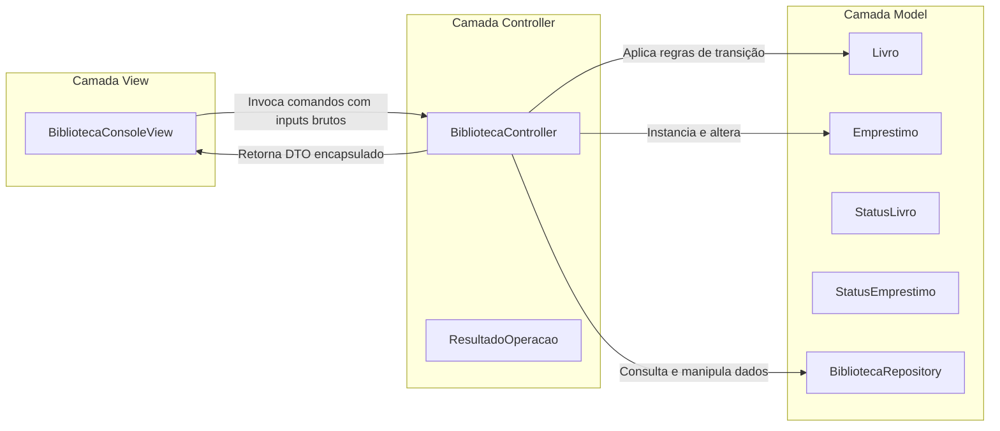

# Documento de Arquitetura de Software — Padrão MVC
**Projeto:** BiblioTech — Sistema de Gerenciamento de Biblioteca  
**Metodologia:** RUP — Disciplina de Análise e Design (Fase de Elaboração)  

---

## 1. Visão Geral da Arquitetura
O sistema **BiblioTech** adota o padrão arquitetural **MVC (Model-View-Controller)** com objetivo de garantir alta coesão e baixo acoplamento entre a interface de interação com o usuário, a lógica de coordenação e as regras de negócio do domínio.

---

## 2. Responsabilidades de Cada Camada

### 2.1 Camada Model (Modelo de Domínio e Persistência)
- **Localização:** `br.com.bibliotech.model.*`
- **Responsabilidade:** Representar o estado e o comportamento das entidades centrais da biblioteca, bem como seu repositório de dados.
- **Componentes:**
  - `model.dominio.Livro`: Representa a obra literária no acervo, controlando seus atributos fundamentais (`id`, `titulo`, `autor`, `isbn`, `anoPublicacao`) e seu ciclo de vida via enum `StatusLivro`. Métodos como `emprestar()` e `devolver()` protegem a integridade do estado da entidade.
  - `model.dominio.Emprestimo`: Modela a transação entre o livro e o leitor, contendo prazos (`dataEmprestimo`, `dataDevolucaoPrevista`, `dataDevolucaoEfetiva`), locatário e enum `StatusEmprestimo`.
  - `model.repositorio.BibliotecaRepository`: Encapsula a persistência e busca dos objetos em coleções em memória (`List<Livro>` e `List<Emprestimo>`), garantindo a geração de IDs únicos e isolando o restante da aplicação dos detalhes de armazenamento.
- **Regra Arquitetural:** O Model **não conhece** nem faz referências à View ou ao Controller.

### 2.2 Camada View (Interface do Usuário)
- **Localização:** `br.com.bibliotech.view.*`
- **Responsabilidade:** Única e exclusivamente interagir com o usuário humano.
- **Componentes:**
  - `view.BibliotecaConsoleView`: Exibe os menus via terminal, captura os dados digitados através do teclado (`java.util.Scanner`), formata a saída de listas e exibe as mensagens de sucesso ou de erro retornadas pelo Controller.
- **Regra Arquitetural:** A View **nunca executa regras de negócio** (ex.: nunca decide se um livro pode ou não ser emprestado e nunca altera atributos de entidade diretamente). Ela apenas repassa as intenções do usuário ao Controller.

### 2.3 Camada Controller (Coordenação e Mediação)
- **Localização:** `br.com.bibliotech.controller.*`
- **Responsabilidade:** Agir como o maestro da aplicação.
- **Componentes:**
  - `controller.BibliotecaController`: Recebe as solicitações da View, valida se os parâmetros básicos estão presentes, consulta o `BibliotecaRepository`, orquestra a execução dos métodos de domínio no Model e devolve um objeto estruturado de resposta (`ResultadoOperacao<T>`).
  - `controller.ResultadoOperacao<T>`: Objeto auxiliar (DTO) que transporta o status da operação (`sucesso = true/false`), a mensagem descritiva para o usuário e o objeto resultante (quando houver).
- **Regra Arquitetural:** O Controller não manipula formatação de console nem faz `System.out.println`. Ele comunica-se por meio de retorno de métodos e objetos tipados.

---

## 3. Justificativa das Decisões Técnicas

1. **Java 17 LTS Puro:** Ausência intencional de frameworks pesados (Spring, Hibernate, etc.) para que todos os conceitos de Orientação a Objetos, polimorfismo, encapsulamento e padrões de projeto fiquem transparentes e avaliáveis academicamente.
2. **DTO `ResultadoOperacao`:** Evita que a View precise tratar exceções de baixo nível não tratadas ou verificar objetos nulos diretamente, promovendo um fluxo limpo e defensivo.
3. **Persistência em Memória com Carga Inicial:** Facilita a execução imediata em qualquer computador sem necessidade de instalação ou configuração prévia de SGBD (PostgreSQL, MySQL), mantendo o foco nos objetivos centrais da disciplina.
