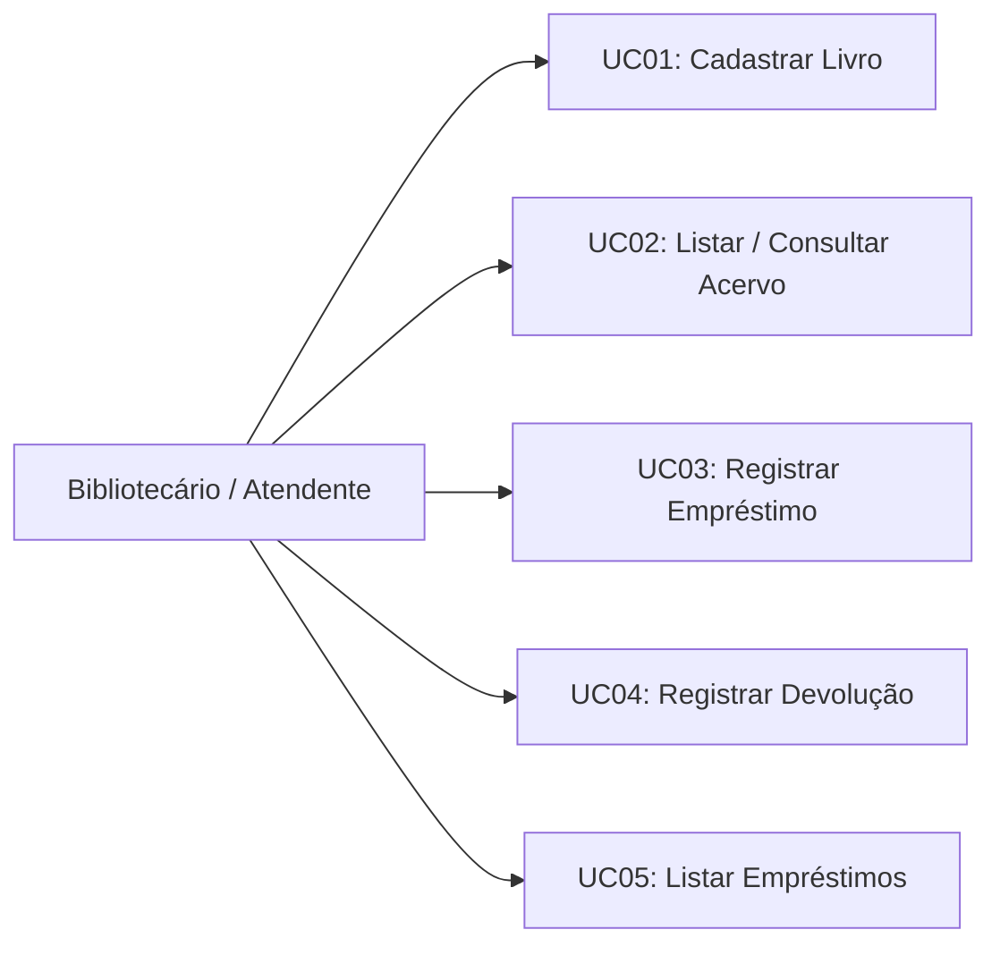

# Especificação de Casos de Uso
**Projeto:** BiblioTech — Sistema de Gerenciamento de Biblioteca  
**Metodologia:** RUP — Disciplina de Requisitos (Fase de Concepção)  

---

## 1. Diagrama Geral de Casos de Uso

---

## 2. Detalhamento dos Casos de Uso

### UC01 — Cadastrar Livro
- **Ator Primário:** Bibliotecário / Atendente.
- **Pré-condições:** O sistema está em execução e pronto para receber comandos.
- **Pós-condições:** O exemplar é armazenado no acervo com status `DISPONIVEL` e um identificador único atribuído.
- **Fluxo Principal:**
  1. O ator seleciona a opção "Cadastrar Livro" no menu.
  2. O sistema solicita: Título, Autor, ISBN e Ano de Publicação.
  3. O ator informa os dados solicitados.
  4. O sistema valida os campos (RN04) e verifica a unicidade do ISBN (RN01).
  5. O sistema persiste a nova instância de `Livro` com status `DISPONIVEL`.
  6. O sistema exibe mensagem de confirmação com os dados do livro cadastrado.
- **Fluxos Alternativos / Exceções:**
  - **4a. Campos vazios:** O sistema identifica que título, autor ou ISBN estão vazios, rejeita o cadastro e exibe mensagem de alerta. O fluxo retorna ao menu.
  - **4b. ISBN duplicado:** O sistema identifica que já existe obra com aquele ISBN, cancela a operação e informa a ocorrência ao usuário.

---

### UC02 — Listar / Consultar Acervo
- **Ator Primário:** Bibliotecário / Atendente.
- **Pré-condições:** Sistema em execução.
- **Pós-condições:** Nenhuma alteração de estado no sistema; dados exibidos ao usuário.
- **Fluxo Principal:**
  1. O ator seleciona a opção "Listar Livros" ou "Consultar Livro".
  2. O sistema recupera a lista de livros do repositório.
  3. O sistema formata os dados em tabela ou lista amigável contendo ID, Título, Autor, ISBN, Ano e Status.
  4. O ator visualiza o catálogo e pressiona uma tecla para retornar ao menu.
- **Fluxos Alternativos / Exceções:**
  - **2a. Acervo vazio:** Caso nenhum livro esteja cadastrado, o sistema exibe mensagem informativa ("Nenhum livro registrado no momento").

---

### UC03 — Registrar Empréstimo
- **Ator Primário:** Bibliotecário / Atendente.
- **Pré-condições:** Ao menos um livro cadastrado no sistema.
- **Pós-condições:** Uma nova instância de `Emprestimo` é criada com status `ATIVO`; o livro associado tem seu status alterado para `EMPRESTADO`.
- **Fluxo Principal:**
  1. O ator seleciona a opção "Registrar Empréstimo".
  2. O sistema lista os livros com seus respectivos IDs e títulos para facilitar a escolha.
  3. O ator informa o ID do livro e o Nome do Locatário.
  4. O sistema localiza o livro pelo ID informado.
  5. O sistema verifica se o livro está com status `DISPONIVEL` (RN02).
  6. O sistema instancia o `Emprestimo`, registra a data atual, calcula a data de devolução para 14 dias (RN05) e define o status como `ATIVO`.
  7. O sistema altera o status do `Livro` para `EMPRESTADO`.
  8. O sistema exibe mensagem de sucesso com o comprovante dos dados do empréstimo.
- **Fluxos Alternativos / Exceções:**
  - **4a. Livro não encontrado:** O sistema informa que o ID não corresponde a nenhum exemplar cadastrado e aborta a operação.
  - **5a. Livro indisponível:** O sistema detecta que o status do exemplar já é `EMPRESTADO`, rejeita a solicitação e exibe mensagem explicando que o livro não pode ser emprestado no momento.

---

### UC04 — Registrar Devolução
- **Ator Primário:** Bibliotecário / Atendente.
- **Pré-condições:** Existência de pelo menos um empréstimo com status `ATIVO`.
- **Pós-condições:** O `Emprestimo` tem seu status alterado para `FINALIZADO` e sua data de devolução efetiva registrada; o `Livro` correspondente volta a ter status `DISPONIVEL`.
- **Fluxo Principal:**
  1. O ator seleciona a opção "Registrar Devolução".
  2. O sistema exibe os empréstimos atualmente ativos para seleção.
  3. O ator informa o ID do empréstimo que deseja encerrar.
  4. O sistema recupera o registro do empréstimo e valida se ele está `ATIVO`.
  5. O sistema registra a data atual como data de devolução efetiva e muda o status do empréstimo para `FINALIZADO`.
  6. O sistema altera o status do livro associado para `DISPONIVEL` (RN03).
  7. O sistema exibe mensagem de confirmação de devolução com sucesso.
- **Fluxos Alternativos / Exceções:**
  - **4a. Empréstimo não encontrado:** O sistema informa que o ID do empréstimo é inválido.
  - **4b. Empréstimo já finalizado:** O sistema alerta que o empréstimo informado já se encontra encerrado.

---

### UC05 — Listar Empréstimos
- **Ator Primário:** Bibliotecário / Atendente.
- **Pré-condições:** Sistema em execução.
- **Pós-condições:** Nenhuma alteração de estado no sistema; dados exibidos ao usuário.
- **Fluxo Principal:**
  1. O ator seleciona a opção "Listar Empréstimos".
  2. O sistema busca todas as transações de empréstimo (ativas e finalizadas).
  3. O sistema apresenta em tela os dados: ID do Empréstimo, Livro, Locatário, Data de Empréstimo, Data Prevista, Data de Devolução Efetiva e Status.
  4. O ator examina as informações e retorna ao menu.
- **Fluxos Alternativos / Exceções:**
  - **2a. Nenhum empréstimo registrado:** O sistema informa que o histórico está vazio.

---

## 3. Matriz de Rastreabilidade (Requisitos vs. Casos de Uso)

| Requisito Funcional | Caso de Uso Relacionado | Cobertura |
| :---: | :---: | :---: |
| **RF01** (Cadastrar Livro) | UC01 | Completa |
| **RF02** (Listar Acervo) | UC02 | Completa |
| **RF03** (Consultar Livro) | UC02 | Completa |
| **RF04** (Registrar Empréstimo) | UC03 | Completa |
| **RF05** (Registrar Devolução) | UC04 | Completa |
| **RF06** (Listar Empréstimos) | UC05 | Completa |
